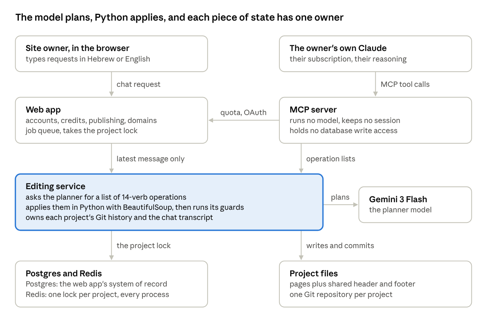

# 42,000 tokens, every turn: budgeting the context of an LLM edit planner

*By Zahi Raifer*

Most discussions of LLM cost focus on the model's price per token. In practice, the number that matters more is how many tokens you send, and whether that number is the same on Tuesday as it was on Monday. This is a look at how the context for the edit planner in Orivox, a Hebrew-first AI website builder, is put together, and at one benchmark that changed how we feed pages to the model.

## The setting

Orivox edits customer websites through a planner model (Gemini 3 Flash). The planner never writes files. It reads the page, decides what to change, and replies with a list of small operations, such as `set_text` or `add_class`, each aimed at an element by its `data-ai-id`. Python applies that list with BeautifulSoup, runs deterministic checks and commits the result to the project's Git repository.

That division of labor shapes the prompt. The planner needs enough context to make a precise plan, and nothing that would tempt it to do more than plan.

## What goes into one request

Every turn assembles the same five parts, in the same way. Counts below are Gemini's own token counts.

| Part of the request | Tokens |
| --- | --- |
| System prompt with the editing rules | 22,893 |
| Definitions of the 11 tools | 3,538 |
| The page, header and footer inlined (median of 15 real pages) | 16,273 (range 6,302 to 17,767) |
| Last five turns of conversation (median) | about 1,100 |
| The owner's request | about 180 |

Added up, that is roughly 42,000 input tokens per turn.

A few things stand out when you look at the breakdown rather than the total.

**The rules are the biggest single item.** Almost 23,000 tokens describe how to edit: the grammar, the conventions, what the planner may and may not do. That is more than a typical page. It reflects where the difficulty actually lives. Knowing *what* the owner wants is usually easy; knowing how to express it safely in the operation grammar is the part that needs instructions.

**The request itself is tiny.** About 180 tokens. Owners write short messages, and the system does not inflate them.

**History is capped.** Only the last five turns go in, at a median of about 1,100 tokens. The editing service keeps the whole transcript, but the planner sees a fixed window, so a long-running project does not slowly make every request more expensive.

## The fixed half is cached

The rules and tool definitions, about 26,000 tokens, are identical on every turn. Because they never change between requests, they are cached, which makes the fixed part of each request fast and inexpensive. Only the page, the recent turns and the request vary.

This is a good argument for keeping the prompt boring. If the instructions were reassembled per request with dynamic snippets, you would lose that stable prefix. Putting the stable part first and the variable part last is a small structural decision with a direct effect on latency and cost.

## Raw HTML versus a JSON summary

The more interesting decision is how to represent the page.

The intuitive approach is to compress it. Strip the markup down to a compact JSON outline (sections, headings, ids, a bit of text) and let the model work from that. It sounds like it should save tokens and reduce noise.

We tested that against simply sending the raw HTML, on real edit requests. The result: raw HTML gave the same understanding at about half the tokens, and the planner could see every element on the page.

My reading of why it came out that way:

1. **The page already has addresses.** Every element carries a short `data-ai-id`. The HTML itself is the index; a separate summary has to repeat those ids plus enough structure to be useful, and that repetition is not free.
2. **Models read HTML fluently.** Classes, nesting and attributes are information the planner uses. A summary throws some of it away and then spends tokens describing the rest.

There is a sensible exception. Very large pages switch to the summary automatically, so a single oversized page cannot blow out the budget. The default, though, is the real thing.

## The other side of the ledger: output

Input is only half of the story. On the output side, the median reply over 24 benchmark runs was 141 tokens.

That number follows from the design. Because the planner emits operations instead of a new page, a request like "make the FAQ cards dark" comes back as a few class changes on specific ids. Compare that with a rewrite approach, where the output would be on the order of the page itself, roughly the size of the 16,000-token median page above, and where any of those tokens could introduce a change nobody asked for.

So the shape of the system is: a large, mostly cached, predictable input, and a small, precise output. Both properties matter. The first makes cost and latency stable. The second makes changes reviewable and limits what can go wrong.

## Keeping the turn bounded

One more number bounds the whole thing. The planner has 11 tools: the edit tool plus helpers for reading another page, viewing a screenshot, reading a page the owner links to (with consent), taking a palette from an image, generating an image, creating or rewriting pages, creating a page per card, and restoring an earlier version. Helper results flow back to the planner so it can continue, but a turn has a fixed budget of six model calls, and an edit call ends it.

Combined with the fixed context, that means the worst case for a turn is known in advance.

## Takeaways

- Measure the prompt by its parts, not just its total. The breakdown tells you where the real complexity is.
- Put the stable instructions first and let them be cached.
- Cap conversation history at a fixed number of turns; keep the full transcript elsewhere.
- Benchmark your page representation instead of assuming compression helps. For us, raw HTML with stable element ids beat a JSON summary.
- Design the output format so answers are small. A diff-like operation list is cheaper and safer than a regenerated document.

The planner described here is the one behind every edit in [Orivox](https://orivox.org).

## More notes

- [Why I keep the AI on a short leash when it edits a live website](https://medium.com/@zahiraifer/why-i-keep-the-ai-on-a-short-leash-when-it-edits-a-live-website-a60a2050a565) (Medium)
- [What we learned building an AI website builder for a right-to-left language](https://medium.com/@zahiraifer/what-we-learned-building-an-ai-website-builder-for-a-right-to-left-language-bd4aeb50f5aa) (Medium)
- [What Really Happens When You Ask an AI to Change Your Website](https://orivox-notes.gitbook.io/orivox-notes-docs) (GitBook)
- [How Orivox edits websites](https://zenodo.org/records/23616893) (Zenodo)
- [I stopped letting the AI write my customers' websites](https://orivox-notes.kit.com/posts/issue-1-i-stopped-letting-the-ai-write-my-customers-websites) (Kit)
- [Before You Let an AI Run Your Business Website: A 9-Point Reliability Checklist](https://exciting-marigold-f47.notion.site/Before-You-Let-an-AI-Run-Your-Business-Website-A-9-Point-Reliability-Checklist-4032b7b7bea180fdbdbbe5da10b186bf) (Notion)
- [Exposing a website builder to AI agents via MCP](https://zahiraifer.hashnode.dev/exposing-a-website-builder-to-ai-agents-via-mcp-what-an-mcp-server-for-site-generation-looks-like) (Hashnode)
- [42,000 tokens article on Neocities](https://zahiraifer.neocities.org/article.html) (Neocities)
- [Guardrails that don't trust the model](https://zahiraifer.bearblog.dev/guardrails-that-dont-trust-the-model/) (Bear Blog)
- [Why most AI website builders break](https://orivoxnotes.substack.com/p/why-most-ai-website-builders-break) (Substack)
- [Why small businesses still don't have websites in 2026](https://zahiraifer.mataroa.blog/blog/why-small-businesses-still-dont-have-websites-in-2026/) (Mataroa)
- [AI website builders compared for non-English markets](https://paragraph.com/@zahiraifer/ai-website-builders-compared-for-non-english-markets-what-to) (Paragraph)
- [Before you go online: a small business owner's checklist](https://www.tumblr.com/zahiraifer/831253841051828224/before-you-go-online-a-small-business-owners) (Tumblr)
- [איך בונים אתר לעסק קטן עם AI בעשר דקות](https://asakbareshet.wordpress.com/2026/10/23/%d7%90%d7%99%d7%9a-%d7%91%d7%95%d7%a0%d7%99%d7%9d-%d7%90%d7%aa%d7%a8-%d7%9c%d7%a2%d7%a1%d7%a7-%d7%a7%d7%98%d7%9f-%d7%a2%d7%9d-ai-%d7%91%d7%a2%d7%a9%d7%a8-%d7%93%d7%a7%d7%95%d7%aa/) (WordPress)
- [Give Every Element an Address: Building LLM-Editable HTML Pages](https://coderlegion.com/32425/give-every-element-an-address-building-llm-editable-html-pages) (CoderLegion)
- [Give every element an address: how Orivox keeps AI website edits small](https://hackmd.io/zeOCMul6QwadC8ZMW8Pm9g) (HackMD)
- [I built an MCP server that lets Claude create and publish real websites](https://dev.to/t_ra_2020646ab07ca030710b/i-built-an-mcp-server-that-lets-claude-create-and-publish-real-websites-4bam) (DEV)

Also see the full [notes index](/notes).
